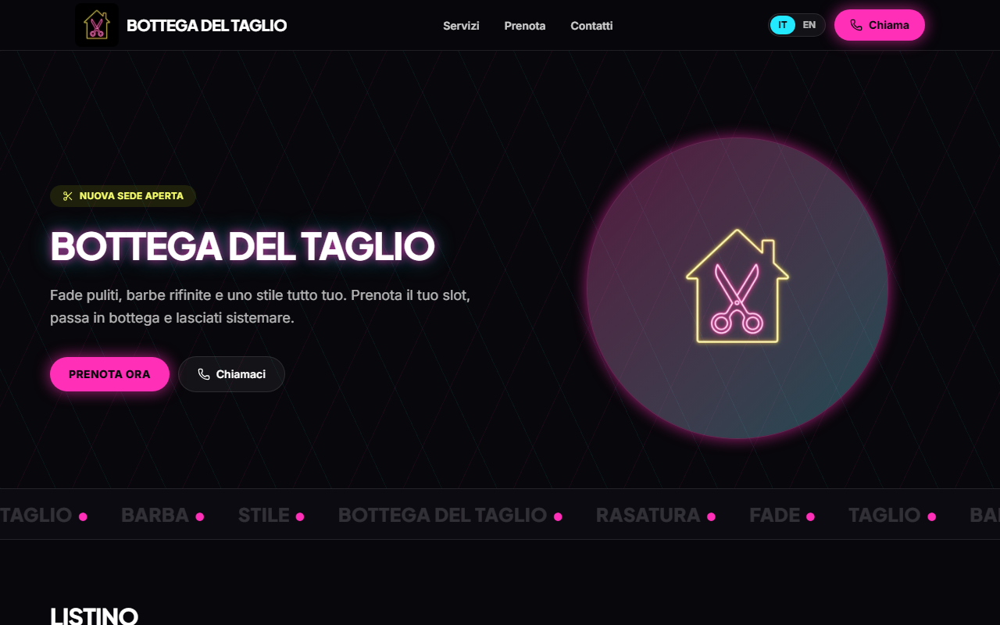
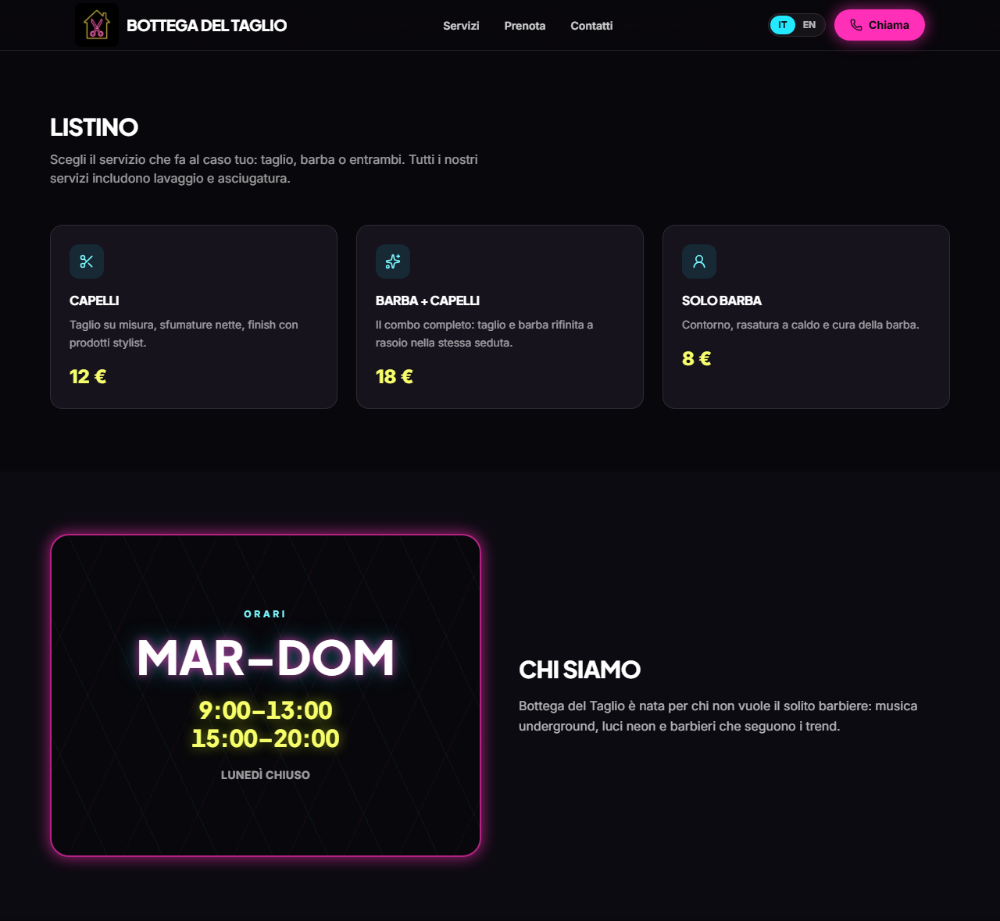
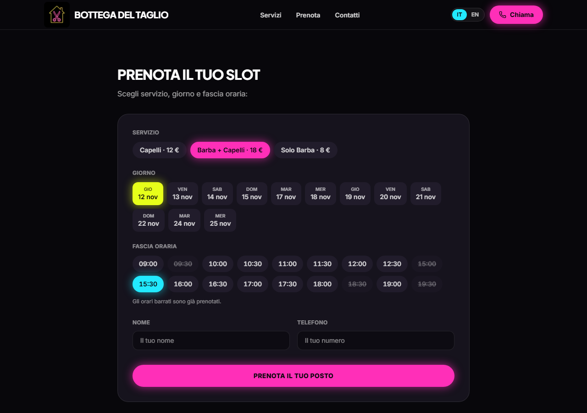
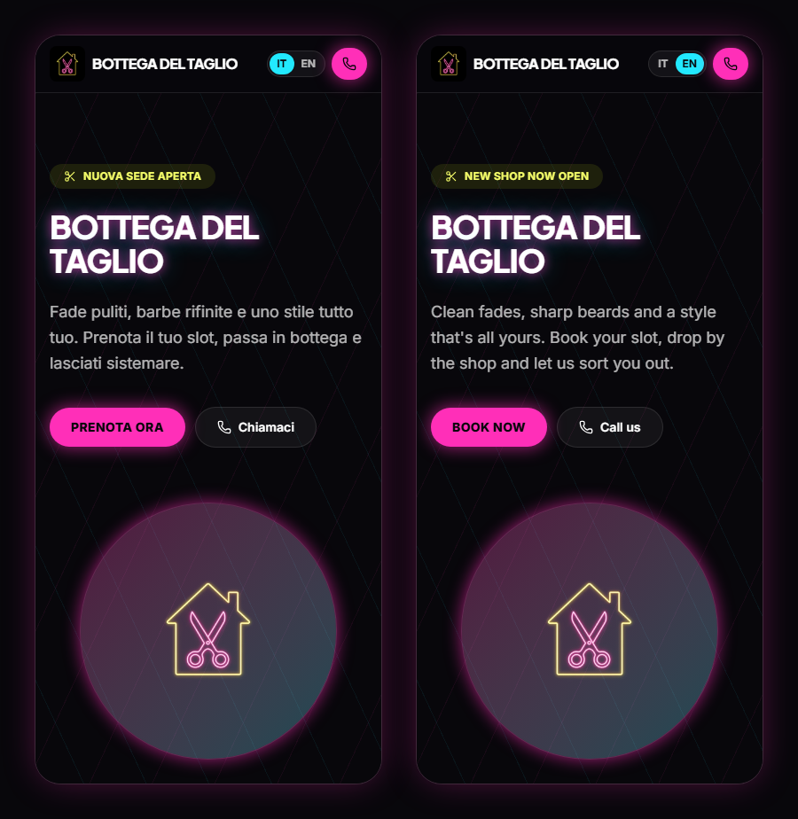

# Bottega del Taglio

Sito vetrina di una barberia immaginaria, con listino, orari e **prenotazione online di un appuntamento**. È una pagina sola, in italiano e inglese, con uno stile «neon» su fondo scuro.



**Demo online:** il sito è pubblicato con GitHub Pages; il link è nella sezione *About* di questo repository.

> **Progetto dimostrativo.** La barberia non esiste: indirizzo e telefono sono fittizi e non c'è un backend. Le prenotazioni passano da una API simulata e restano salvate solo nel browser di chi visita il sito. I pulsanti «Chiama» non avviano chiamate.

## Funzionalità

- **Listino** dei servizi con prezzi formattati nella lingua scelta (12 € / €12).
- **Prenotazione** in tre tocchi: servizio, giorno e fascia oraria. Si prenota da domani per 14 giorni, il lunedì è chiuso e le fasce sono di mezz'ora (9–13 e 15–20, ora italiana).
- **Orari occupati**: ogni giorno ha già qualche appuntamento di altri clienti (simulati) e anche le prenotazioni fatte dal visitatore occupano il loro orario. Gli orari presi appaiono barrati e non si possono scegliere. Se un orario viene occupato nel frattempo (per esempio da un'altra scheda), il form avvisa e propone un altro orario.
- **Italiano e inglese** con un selettore nella barra di navigazione. La scelta resta salvata nel browser.
- **Responsive**, da 320px in su.
- **Accessibile**: contrasti WCAG AA e animazioni che si fermano con «riduci movimento» attivo nel sistema.

| Listino e orari | Prenotazione con orari occupati |
|---|---|
|  |  |



## Tecnologie

[React 19](https://react.dev) · [TypeScript](https://www.typescriptlang.org) · [Vite](https://vite.dev) · [Tailwind CSS 4](https://tailwindcss.com) · [i18next](https://www.i18next.com) · [Motion](https://motion.dev) · [Lucide](https://lucide.dev) · [oxlint](https://oxc.rs)

## Avvio

Serve [Node.js](https://nodejs.org) 20.19+ o 22.12+.

```bash
npm install
npm run dev      # server di sviluppo su http://localhost:5173
npm run build    # controllo dei tipi + build di produzione in dist/
npm run preview  # serve la build di produzione
npm run lint     # oxlint
```

Per aprire il sito direttamente in una lingua: `http://localhost:5173/?lng=en`.

## Come funziona la prenotazione simulata

`src/api/booking.ts` imita un piccolo backend con due funzioni asincrone, ognuna con mezzo secondo di attesa per simulare la rete:

- `fetchBookedSlots(day)` restituisce gli orari già occupati di un giorno;
- `submitBooking(request)` registra la prenotazione, oppure fallisce con `SlotTakenError` se l'orario è già preso.

Gli orari occupati di un giorno sono di due tipi:

- **clienti simulati**: da 3 a 6 appuntamenti al giorno (qualcuno in più il sabato), scelti con un generatore pseudocasuale che usa la data come seme. Così lo stesso giorno mostra sempre gli stessi orari occupati, anche ricaricando la pagina;
- **prenotazioni del visitatore**: salvate nel `localStorage` alla chiave `bottega-del-taglio:bookings`. Se il `localStorage` non è disponibile, per esempio in navigazione privata con lo storage bloccato, restano in memoria fino al ricaricamento della pagina. Per cancellarle basta eliminare quella chiave dagli strumenti per sviluppatori del browser (Application → Local Storage).

## Struttura

```
src/
  main.tsx                 punto di ingresso: stile, i18n e App
  App.tsx                  nav, pagina e footer
  bottega.css              Tailwind con il tema della barberia (palette, font, ombre, animazioni)
  api/booking.ts           API di prenotazione simulata
  assets/logo.webp         logo (nav e hero); una copia è in public/favicon.webp
  components/
    BookingForm.tsx        form di prenotazione
    BottegaNav.tsx         nav con ancore e selettore di lingua
    BottegaFooter.tsx      indirizzo, telefono e orari
    LanguageSwitch.tsx     selettore IT/EN
    ui/Reveal.tsx          comparsa animata delle sezioni allo scroll
  data/
    booking.ts             regole della prenotazione (giorni, fasce, giorno di chiusura)
    contacts.ts            indirizzo e telefono (fittizi)
    services.ts            servizi del listino (slug, prezzo, icona)
  i18n/
    index.ts               configurazione di i18next
    useLocale.ts           lingua attiva e locale per Intl
  locales/
    it.json, en.json       tutti i testi del sito
  portfolio/               pillola «torna al portfolio», solo per chi arriva da flowsi.it
  pages/BottegaHome.tsx    la pagina: hero, marquee, listino, chi siamo, prenotazione
docs/screenshots/          immagini di questo README
.github/workflows/deploy.yml   pubblicazione automatica su GitHub Pages
```

Gli orari della barberia (martedì–domenica, 9–13 e 15–20, lunedì chiuso) sono definiti una volta sola, in `BOOKING` dentro `data/booking.ts`. Da lì vengono ricavati sia gli appuntamenti prenotabili (`SLOTS`) sia le scritte dell'insegna e del footer (`describeOpeningHours`, che usa `Intl` per i nomi dei giorni nella lingua attiva). Per cambiare orari o giorno di chiusura basta modificare `BOOKING`.

## Arrivo dal portfolio

La demo fa parte del portfolio [flowsi.it](https://flowsi.it), che la apre con il parametro `?from=portfolio`. Solo in quel caso, in alto a sinistra, compare una pillola fissa che riporta al portfolio (`src/portfolio/`). Chi arriva da GitHub o da un link diretto non la vede.

- `fromPortfolio.ts`, importato in `main.tsx` prima del render, salva il segnale nel `sessionStorage` (chiave `portfolio:back`) e toglie `from` dall'URL. Così la pillola resta navigando tra le pagine della scheda, ma un link copiato non la porta con sé. Mette anche l'attributo `data-portfolio-back` su `<html>`.
- `BackToPortfolio.tsx` è la pillola, con i testi IT/EN al suo interno. Riporta sempre a `https://flowsi.it/#progetti`: l'indirizzo è fisso nel codice e non letto dall'URL, così nessuno può usarla per mandare altrove.
- Le classi con la variante `back:` (definita nel foglio di stile) valgono solo con quell'attributo: nell'header lasciano spazio alla pillola.

## Pubblicazione su GitHub Pages

Il workflow `.github/workflows/deploy.yml` pubblica il sito a ogni push sul branch `main`. Si può anche avviare a mano dalla scheda *Actions*. Il workflow installa le dipendenze, esegue il build e carica la cartella `dist/` su GitHub Pages.

Il sito viene servito da un sottopercorso, `https://<utente>.github.io/<nome-repository>/`. Per questo il build riceve quel percorso come `base` (`--base=/<nome-repository>/`), letto dal nome del repository: se il repository viene rinominato, il workflow continua a funzionare.

Configurazione, una sola volta: *Settings → Pages → Build and deployment → Source: **GitHub Actions***.

## Lingua

La lingua viene scelta in quest'ordine: il parametro `?lng=it` / `?lng=en` nell'URL, poi la scelta fatta con il selettore (salvata nel `localStorage`), infine la lingua del browser. Il parametro `lng`, una volta letto e salvato, viene tolto dall'URL (`src/i18n/index.ts`): l'indirizzo resta pulito e, ricaricando, non ha la precedenza su una scelta fatta poi con il selettore. Se nessuna corrisponde, il sito è in italiano.

I testi stanno in `src/locales/it.json` e `src/locales/en.json` (namespace `bottega`). I due file hanno la stessa struttura di chiavi. Nome e descrizione dei servizi sono alla chiave `services.items.<slug>`. Date e prezzi sono formattati con `Intl`. L'inglese usa `en-GB`: giorno prima del mese e orari in 24 ore.

Il tono dei testi è diretto e informale: la bottega parla al cliente dando del «tu».

## Design

### Direzione visiva: «Neon»

Fondo quasi nero, con scritte e pulsanti al neon (rosa, giallo, cian) circondati da un alone luminoso. I titoli sono in maiuscolo.

- Il titolo della hero tremola come un'insegna (`animate-flicker`).
- Sotto la hero scorre una fascia di parole (`animate-marquee`).
- Lo sfondo della hero ha una trama di linee diagonali (`neon-lines`) e due macchie di colore sfocate.
- Nel cerchio della hero il logo usa `mix-blend-screen`: il suo fondo nero sparisce e restano solo le linee al neon.
- In «Chi siamo», al posto di una foto, c'è un'insegna al neon con gli orari.
- Pulsanti e badge sono a pillola.

Con «riduci movimento» attivo (`prefers-reduced-motion`) le animazioni si fermano: il titolo resta acceso con un alone fisso (`neon-glow`) e la fascia di parole sta ferma.

### Palette (`bottega.css`, `@theme`)

| Token | Valore | Uso |
|---|---|---|
| `ink-950` | `#08070b` | fondo pagina, testo sui pulsanti neon |
| `ink-900` | `#0d0b12` | fascia del marquee, «Chi siamo», footer, campi del form |
| `ink-800` | `#16131d` | card del listino, form |
| `ink-700` | `#211c2b` | chip non selezionati del form |
| `neon-pink-400/500` | `#ff7ad1` / `#ff2fb8` | pulsanti principali (`500`, hover `400`), puntini del marquee |
| `neon-yellow-400/500` | `#f7ff6b` / `#e6ff1a` | prezzi e badge (`400`), giorno scelto (`500`) |
| `neon-cyan-400/500` | `#7bf7ff` / `#22e9ff` | icone e link al passaggio del mouse (`400`), fascia oraria scelta e lingua attiva (`500`) |

Il testo è bianco, pieno o con opacità (`white/80`, `/70`, `/60`, `/50`). Gli aloni sono `shadow-neon-pink`, `shadow-neon-yellow` e `shadow-neon-cyan`.

Contrasti misurati (WCAG AA = 4,5:1 per il testo normale):

| Combinazione | Contrasto |
|---|---|
| bianco su `ink-950` | 20,09:1 |
| `white/70` su `ink-950` (testo della hero) | 9,80:1 |
| `white/60` su `ink-800` (testo delle card) | 7,14:1 |
| `white/50` su `ink-800` (etichette del form) | 5,30:1 |
| `ink-950` su `neon-pink-500` (pulsanti) | 6,07:1 |
| `neon-yellow-400` su `ink-800` (prezzi) | 17,01:1 |
| `white/50` su `ink-900` (placeholder dei campi) | 5,34:1 |
| `white/15` su `ink-900` (parole del marquee) | 1,50:1, solo decorative |
| `neon-yellow-400` su `ink-950` (orari dell'insegna) | 18,62:1 |
| `neon-cyan-400` su `ink-950` (etichetta «Orari») | 15,87:1 |
| `white/60` su `ink-950` («Lunedì chiuso» nell'insegna) | 7,32:1 |

Gli orari già prenotati (`white/30` barrato su `ink-700/40`) sono volutamente poco contrastati: il loro stato è comunicato anche dalla barratura e, per i lettori di schermo, dal testo «Già prenotato».

### Font

- `font-display`: **Plus Jakarta Sans**, in maiuscolo, per titoli, marchio e pulsanti.
- `font-sans`: **Inter** per il testo.

## Licenza

Distribuito con licenza [MIT](LICENSE).
